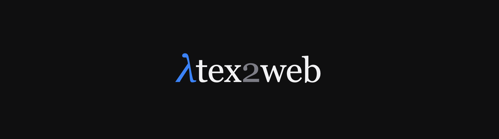
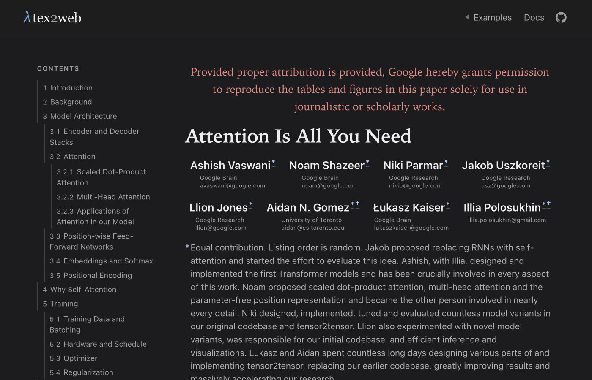
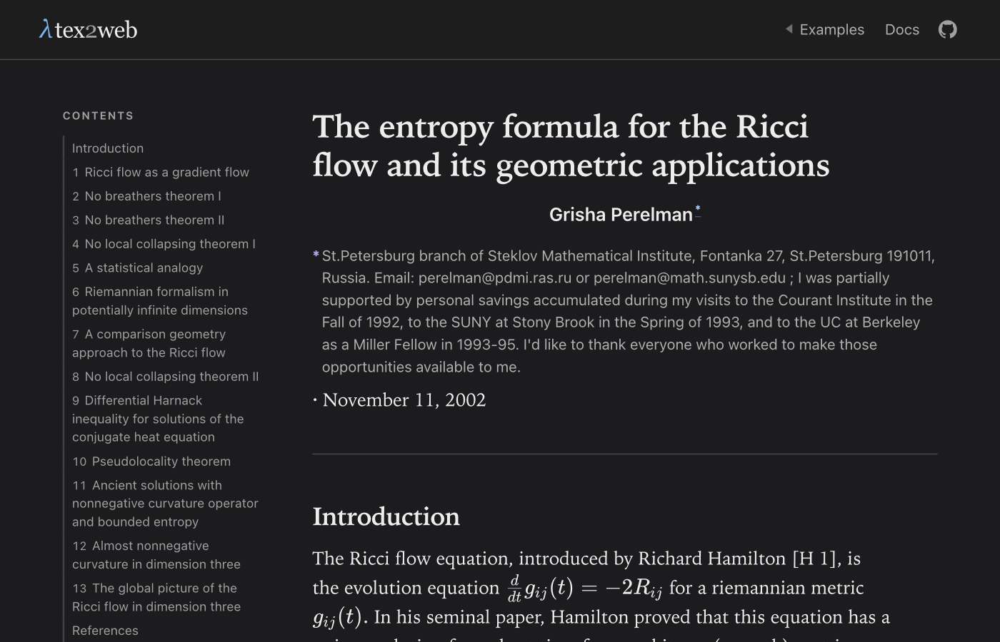
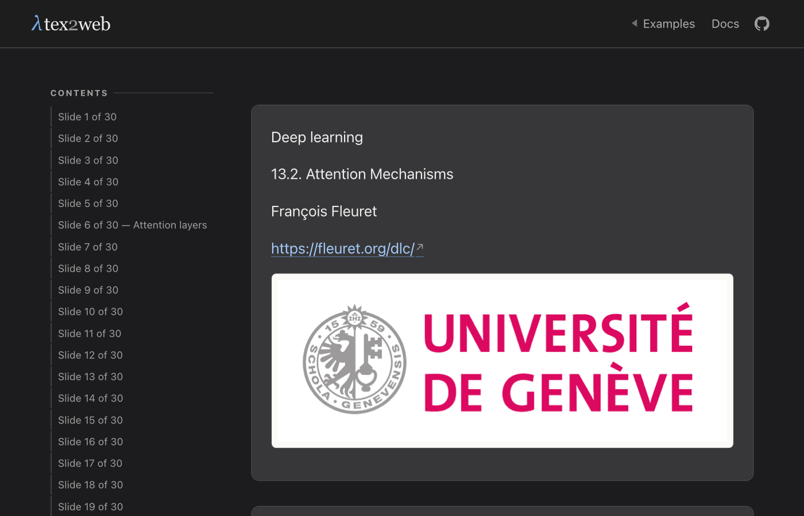

<div align="center">

# latex2web



Turn LaTeX sources into a polished, self-contained static website.

[](https://github.com/leoldev/latex2web)
[](https://nodejs.org)
[](LICENSE)

</div>

---

```sh
npm install leoldev/latex2web
npx leoldev/latex2web paper.tex -o dist
```

Node 20+ required, no other dependencies are required.

The output is HTML with real rendered text, math, figures, table of contents,
cross-references.

## Examples

These are three documents from [showcase/papers](showcase/papers), converted from
their original sources without changes. The rest of the showcase is at
[leoldev.github.io/latex2web](https://leoldev.github.io/latex2web/).

### A paper



*Vaswani et al., "Attention Is All You Need", NeurIPS 2017.* Demonstrates λtex2web's figure and table derivation capabilities.

### Math



*Grisha Perelman, "The entropy formula for the Ricci flow", 2002.* Even on 40+ pages of tensor calculus too, λtex2web typesets 57 math equations cleanly.

### A deck



*François Fleuret, Deep Learning Course, lecture 13.2.* A demo of λtex2web's capabilities in transcribing thirty lecture slides on attention mechanisms to a website.

## Themes

| Theme | For |
|---|---|
| `paper` | Serif, print-inspired, generous measure. Sticky contents rail, PDF-ready. |
| `notes` | Sans-serif reading notes, wide measure, skimmable. |
| `slides` | One slide per section, scroll-snap deck, handout on print. |
| `docs` | Reference pages: sections in cards, no contents rail. |
| `landing` | A front page: hero, a ruled list of examples, then a contents rail. |

Every theme follows the reader's system light/dark and `prefers-reduced-motion` modes. Pick one with `--theme`.

## Documentation

The [Docs](https://leoldev.github.io/latex2web/site/docs.html) covers the commands and options, what is and is not converted, TikZ and figures, decks, palettes and tokens, and the configuration file (you can write your own theme too).

## Not supported

PDF input · BibTeX · beamer overlays (since there is no presentation) ·
TikZ without a TeX engine installed · user plugins.

## Development

```sh
npm test
node showcase/build.mjs      # rebuild the site in site/ and index.html
```

| Path | Purpose |
|---|---|
| `src/cli.js` | argument parsing, exit codes, watch wiring |
| `src/index.js` | `build()`: discovery, `\input` resolution, assets, page assembly |
| `src/parse.js` | LaTeX → block tree, labels, counters, frame numbering |
| `src/render.js` | block tree → HTML, KaTeX, table of contents, footnotes |
| `src/contrast.js` | WCAG relative luminance, and the palette ramp repair |
| `src/chrome.js` | the masthead and footer, shared by every layout |
| `src/highlight.js` | dependency-free syntax highlighter for listings |
| `templates/base.html` | the single HTML shell all themes fill in |
| `themes/*.css` | one file per theme |
| `showcase/` | the site's own sources: three converted documents and its pages |
| `test/` | `node:test` suites |

`src/contrast.js` is the one file that is not about LaTeX, and it is kept separate
for that reason: every palette ramp is measured against WCAG at test time, so a
ramp that stops being monotonic, or drops below 4.5:1, fails a test instead of
shipping.